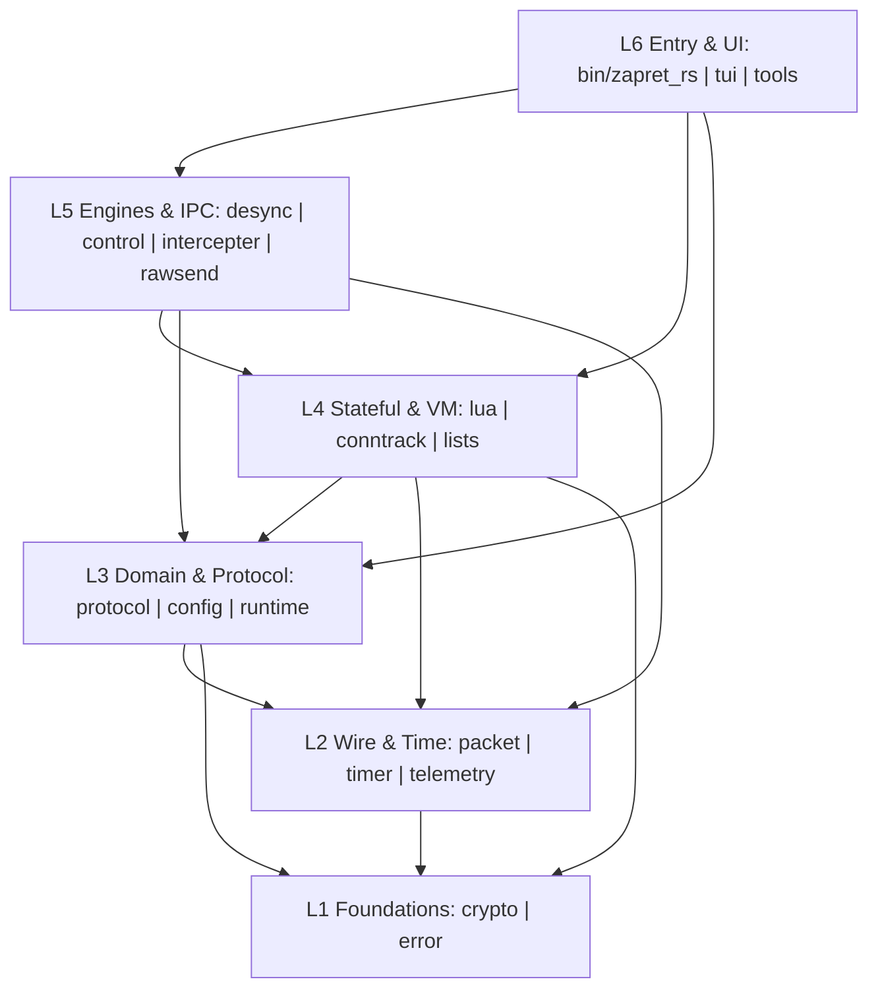

# Architecture Overview

`zapret-rs` is a single-binary, pure-Rust Deep Packet Inspection (DPI) circumvention suite pairing a stateful NFQUEUE/WinDivert packet processing daemon (`nfqws2`), an embedded LuaJIT scripting VM, a multi-domain Strategy Finder, an interactive `ratatui` TUI (`tui` feature), an embedded HTTP/SSE Web UI, and CLI network utilities.

## 1. Library Module Stratification & Dependency DAG

All library code lives under [src/](../../src) and is exported through [src/lib.rs](../../src/lib.rs) across 18 subsystems (`17` unconditional plus feature-gated `tui`). Internal dependencies strictly flow downward in layers with zero circular module edges:

Key architectural boundaries across layers:

| Layer | Modules | Core Responsibility |
|---|---|---|
| L1 Foundations | `crypto`, `error` | Pure-Rust SHA-2/HMAC/HKDF/AES/AES-GCM (`CryptoError`), crate-wide `ZapretError` |
| L2 Wire & Time | `packet`, `timer`, `telemetry` | Bounded `ByteReader`, L3/L4 dissect & reconstruct, monotonic boottime `TimerPool`, `PacketCounters` |
| L3 Domain & Protocol | `protocol`, `config`, `runtime` | L7 classifiers, TLS/HTTP/QUIC parsing, `AppConfig` & TOML schema, POSIX privilege/capability/process guards |
| L4 Stateful & VM | `conntrack`, `lists`, `lua` | 5-tuple TCP/UDP `ConntrackPool`, bounded stream reassembly, hostlists/autohostlist/ipsets/`IpCache`, hardened LuaJIT VM |
| L5 Engines & IPC | `desync`, `intercepter`, `rawsend`, `control` | Profile routing + Lua action execution (`DesyncEngine`), NFQUEUE / WinDivert loops, raw L3 injectors, JSON control server |
| L6 Entry & UI | `tools`, `tui`, `bin/zapret_rs.rs` | Multicall CLI dispatcher, Linux/Windows daemons, Strategy Finder, Web UI, `ip2net`, `mdig`, `dns`, installer, 7-tab TUI |

## 2. Single-Binary Multicall & Feature Gates

[src/bin/zapret_rs.rs](../../src/bin/zapret_rs.rs) routes invocations through `dispatch_headless_applet` in [src/tools/multicall.rs](../../src/tools/multicall.rs) before falling back to `ZapretTuiCli`:

1. **BusyBox-style `argv[0]` matching (`resolve_argv0_applet`):** Symlinks or renamed copies (`nfqws2`, `strat_finder`, `strat-finder`, `ip2net`, `mdig`) invoke their applet directly. `zapret-rs install --symlinks` creates these links beside the installed binary.
2. **Explicit subcommand dispatch:** `daemon` (or `nfqws2`), `scan` (or `strat_finder`), `ip2net`, `mdig`, `install`, `uninstall`, `dns`, and `web`.
3. **Default interactive mode:** Bare `zapret-rs` launches `run_tui` when compiled with `default = ["tui"]` in [Cargo.toml](../../Cargo.toml). Headless builds compiled with `--no-default-features` exclude `ratatui`, `crossterm`, and `src/tui/` completely, printing a diagnostic message if launched without a subcommand.

## 3. Repository Hygiene & Coding Invariants

Every `cargo nextest run` execution runs structural enforcement tests in [tests/repo_hygiene.rs](../../tests/repo_hygiene.rs):

- **File-size ceiling (`no_monolithic_rust_files`):** Excluding blank lines, comments, lone `{`/`}` brace lines, and exempted binary payloads (`src/config/blobs.rs`), non-exempt production files under `src/` stay at or below `450` logical code lines (`MAX_SRC_CODE_LINES`) and integration tests under `tests/` at or below `500` (`MAX_TEST_CODE_LINES`).
- **Pure facade rule (`mod_rs_files_are_pure_facades`):** Every `src/**/mod.rs` may contain only `pub mod`, `pub use`, `#[cfg(...)]` attributes, and comments.
- **Panic and test isolation (`src_contains_no_inline_tests_or_unwrap_expect`):** Production code under `src/` cannot contain `#[cfg(test)]`, `#[test]`, `.unwrap(`, or `.expect(`. All tests reside in `tests/`.
- **Inline keybind guard (`no_inline_keybind_bars_in_tab_panels`):** Renders such as `render_config.rs`, `render_status.rs`, and `inspect_ui.rs` must not duplicate inline `styled_key_hints` rows; global/tab bindings belong in the `?` popup (`src/tui/keybinds.rs`).

## 4. Deep-Dive Guides & Decision Records

- [Packet Pipeline, Conntrack & Autohostlist Engine](packet-pipeline.md)
- [Embedded LuaJIT VM, Timers & Pure-Rust Cryptography](lua-crypto-runtime.md)
- [Privilege Lifecycle, Platform Backends, Control IPC & CLI/Web Tools](runtime-ipc-security.md)
- [TUI State Machine, Centralized `config.toml` & Remappable Keybinds](tui-and-config.md)
- [Architecture Decision Records (ADRs)](../decisions/)
