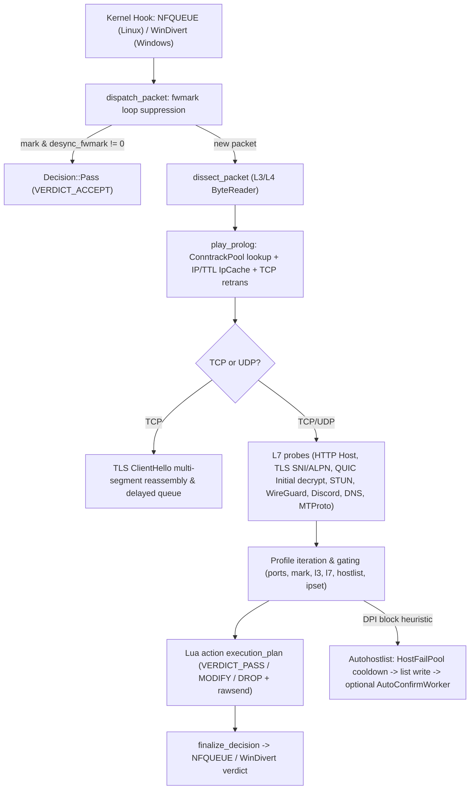

# Packet Pipeline, Conntrack & Autohostlist Engine

This document covers Layers 2 through 5 for live packet interception, wire parsing, stateful TCP/UDP connection tracking, L7 discovery, DPI desync execution, and autohostlist learning.

## 1. End-to-End Packet Flow

## 2. Interception & Injection (`src/intercepter/`, `src/rawsend/`)

Packet capture and verdict enforcement are abstracted behind `PacketIntercepter` and `PacketSender` traits (`src/intercepter/types.rs`, `src/rawsend/mod.rs`), allowing deterministic in-memory packet simulation in integration tests alongside OS-specific drivers:

- **Linux NFQUEUE (`src/intercepter/nfqueue.rs`):** `QueueCatcher` binds netlink queues with `setsockopt(SO_RCVBUF)` tuning, resolves interface names via cached `SIOCGIFNAME` (`IfNameResolver`), and polls using `libc::poll` bounded by timer deadlines (`poll_timeout_ms`). Each wakeup drains at most `MAX_NFQUEUE_BATCH_PACKETS = 64` packets (`nfqueue.rs:25`) before yielding back to timers, `SIGHUP`, and control-socket commands.
- **Linux Raw Injection (`src/rawsend/sender.rs`):** `RawSender` uses IPv4/IPv6 raw sockets with `IP_HDRINCL`, configurable `SO_BINDTODEVICE` (`--bind-fix4`/`--bind-fix6`), and `SO_MARK` (`desync_fwmark`) so injected decoys bypass NFQUEUE re-interception.
- **Windows WinDivert (`src/intercepter/windivert.rs`, `src/rawsend/windivert.rs`):** Captures network-layer packets into 64 KiB buffers using manual-reset Win32 events and heap-pinned `OVERLAPPED` storage. `WinDivertSender` injects packets using `WINDIVERT_FLAG_SEND_ONLY` (`0x0008`) without recalculating TCP/UDP checksums (`WinDivertHelperCalcChecksums` is skipped when invalid checksums like `badsum` are preserved intentionally).

## 3. Wire Dissection & Reconstruction (`src/packet/`)

- **Zero-panic parsing:** `ByteReader` (`src/packet/byte_reader.rs`) performs checked slice reads returning `PacketError`. `dissect_packet` (`src/packet/dissecter.rs`) validates IPv4 `version == 4` and `IHL >= 5`, walks IPv6 extension-header chains (`walk_ipv6_exthdrs` in `src/packet/ipv6_ext.rs`), parses TCP options (`MSS`, `Scale`, `SACK`, `TS`), UDP headers, and ICMP/ICMPv6 embedded payloads, returning a `DissectedPacket`.
- **Rebuilding & Checksums:** `reconstruct_packet` and `ReconstructOptions` (`src/packet/reconstruct.rs`, `src/packet/header_encode.rs`, `src/packet/checksum.rs`) re-encode modified IPv4/IPv6 headers, optional extension headers, TCP options, and pseudo-header L4 checksums without modifying untouched segments when only headers or TTL/badsum flags are altered.

## 4. Conntrack Pool & Stream Reassembly (`src/conntrack/`)

`ConntrackPool` (`src/conntrack/pool.rs`, `src/conntrack/types.rs`) indexes flows by normalized bidirectional `ConnKey` `(src, dst, sport, dport, l3proto, l4proto)` where client initiator endpoints always occupy `(src, sport)` even if tracking initializes on a `SYN-ACK`.

### Flow Capacity & Lifecycle Limits

| Parameter / Limit | Default Value | Purpose & Eviction Policy |
|---|---|---|
| `DEFAULT_CTRACK_MAX_ENTRIES` | `65_536` flows | Caps concurrent tracked connections; evicts oldest entries when full (`0` = unbounded) |
| `DEFAULT_CTRACK_TIMEOUT_SYN` | `60` s | Idle expiration in `SYN` state (`CTRACK_T_SYN`) |
| `DEFAULT_CTRACK_TIMEOUT_EST` | `300` s | Idle expiration in `ESTABLISHED` state (`CTRACK_T_EST`) |
| `DEFAULT_CTRACK_TIMEOUT_FIN` | `60` s | Idle expiration in `FIN`/`RST` state (`CTRACK_T_FIN`) |
| `DEFAULT_CTRACK_TIMEOUT_UDP` | `60` s | Idle expiration for UDP flows (`CTRACK_T_UDP`) |
| `DEFAULT_CTRACK_PURGE_INTERVAL` | `10` s | Minimum monotonic interval between full purge sweeps (`last_purge_sec`) |
| `DEFAULT_GLOBAL_REASM_BUDGET_BYTES` | `32 MiB` | Shared `GlobalBufferBudget` across all active `StreamReassembler` buffers & delayed queues |
| `TCP_MAX_REASM` / `UDP_MAX_REASM` | `16_384` bytes | Maximum per-flow reassembly buffer size for multi-segment ClientHello / UDP payloads |
| `RAW_PACKET_QUEUE_DELAYED_MAX` | `64` packets | Maximum raw packets queued per flow while awaiting reassembly completion |
| `REASM_MAX_NEG` | `1 MiB` (`0x10_0000`) | Maximum negative overlap delta tolerated before aborting out-of-order reassembly |

When multi-segment TLS ClientHello reassembly completes (or overflows `TCP_MAX_REASM` / `RAW_PACKET_QUEUE_DELAYED_MAX` / `GlobalBufferBudget`), `DesyncEngine` replays queued raw packets (`replay_and_finish` in `src/desync/reasm_replay.rs`) through the resolved profile and returns `PacketOutcome::Reasm` or `PacketOutcome::Desync`.

## 5. L7 Discovery, Lists & Autohostlist (`src/protocol/`, `src/lists/`, `src/desync/`)

- **L7 protocol parsers (`src/protocol/`):** Identify HTTP (`Host`, status `451`, external `<meta http-equiv="refresh">` redirects via `url_looks_off_domain`), TLS (`ClientHello` SNI/extensions, fatal TLS `Alert` detection `is_tls_fatal_alert`, `tls_mod`), QUIC Initial packet decryption (RFC 9001 v1, RFC 9369 v2, IETF drafts 22..32), DNS queries/responses, STUN, WireGuard, Discord IP discovery, and MTProto. Wire hostnames pass `sanitize_wire_hostname` to reject directive/control characters.
- **Profile evaluation & cutoffs (`src/desync/engine.rs`, `src/desync/verdict.rs`):** Profiles iterate in declaration order over `l3`/`mark`, `port` intervals, `hostlist`, `hostlist_exclude`, `ipset`, `ipset_exclude`, and L7 payload filters. Hostlist/ipset files use a 1-second `stat(2)` reload cooldown bypassed on explicit `SIGHUP` or `reload_lists` IPC. Lua actions execute in order with short-circuit `InstanceCutoff` tracking and `VERDICT_PASS` / `VERDICT_MODIFY` / `VERDICT_DROP` aggregation.
- **IpCache (`src/lists/ipcache.rs`):** Rate-limited `(ip, iface)` cache with stack-inlined `16`-byte interface keys (`INLINE_IFACE_CAP`), storing incoming TTLs and DNS-learned hostnames with bounded eviction.
- **Autohostlist Learning & Confirmation (`src/lists/hostfail.rs`, `src/lists/autohost_triggers.rs`, `src/desync/auto_confirm.rs`):**
  1. Passive failure triggers include outgoing TCP retransmissions, reverse forged `TH_RST` with `rseq == 0`, unencrypted incoming TLS fatal `Alert` records, premature empty `TH_FIN` teardowns, HTTP `451` responses, and off-domain `<meta refresh>` block pages.
  2. `HostFailPool` (capped at `DEFAULT_MAX_HOSTFAIL_ENTRIES = 16_384`, max `16` siblings per parent) coalesces burst failures per host (`fail_cooldown_sec`, default `2s`).
  3. Sibling rollup promotes matching parent domains after `sibling_threshold` distinct subdomains fail, guarded by `safe_parent_domain` against collapsing two-label ccTLD SLDs (`co.uk`) or multi-tenant roots (`github.io`, `pages.dev`, `amazonaws.com`).
  4. When `confirm_block` is enabled on a profile, `AutoConfirmWorker` (`src/desync/auto_confirm.rs`) verifies suspect hosts out-of-band over direct TCP/TLS/HTTP probes without blocking the packet thread.
