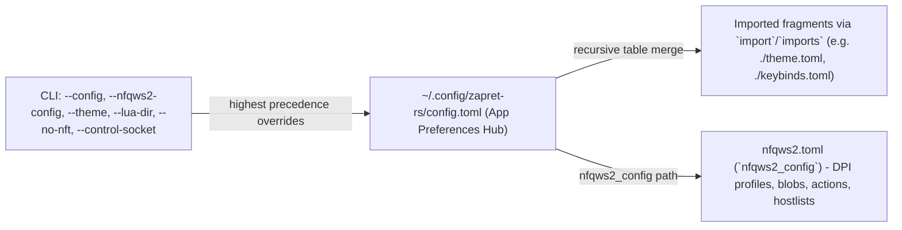

# TUI State Machine, Centralized `config.toml` & Remappable Keybinds

This document covers the interactive `ratatui` interface under [src/tui/](../../src/tui/) (gated behind `--features tui`, enabled by default).

## 1. Centralized App Configuration vs. `nfqws2.toml`

`zapret-rs` intentionally separates **user UI preferences** from **DPI packet strategy profiles**:

- **Auto-detection (`is_centralized_app_config` in [app_config.rs](../../src/tui/app_config.rs)):** `--config` accepts either a centralized `config.toml` (identified by `import`, `imports`, `nfqws2_config`, `lua_dir`, `no_nft`, `theme`, or `keybinds`) or a direct `nfqws2.toml` (identified by `profiles`, `qnum`, `fwmark`, `lua_init`, etc.). `--nfqws2-config` explicitly overrides `nfqws2_config` inside `config.toml`.
- **Recursive modular imports ([app_config_import.rs](../../src/tui/app_config_import.rs)):** Both top-level `import`/`imports` (single string or array, relative to the importing file or `~/`) and `[theme].import` merge fragments recursively up to `MAX_IMPORT_DEPTH = 16` with canonical path cycle detection. Top-level theme-only files (`theme.toml`) auto-wrap under `[theme]`, and keybind-only files (`keybinds.toml`) auto-wrap under `[keybinds]`.
- **First-run generation & sparse surgical saves ([app_config_save.rs](../../src/tui/app_config_save.rs), [toml_splice.rs](../../src/tui/toml_splice.rs)):**
  - On first launch when `config.toml` is absent (`ensure_default_app_config_file`), startup writes a minimal `config.toml` pointing to `nfqws2.toml` and inserting `import = "./theme.toml"` if a sibling `theme.toml` already exists (otherwise `theme.toml` is ignored unless imported or passed via `--theme`).
  - Explicit saves from Tab 7 (`Settings`) call `save_settings_surgically`, which omits default keybinds (`sparse_keybinds_table`) and baseline theme colors (`sparse_theme_table`), preserves `# comments` and `import` lines via `replace_sections` / `update_root_scalars`, and writes theme changes directly back into an imported standalone `theme.toml` when no inline `[theme]` block exists.

## 2. Remappable Keybinding Engine & Dynamic UI chrome

- **Specs & matching ([keybind_spec.rs](../../src/tui/keybind_spec.rs), [keybind_schema.rs](../../src/tui/keybind_schema.rs)):** Every binding accepts a single key string (`"q"`, `"F1"`, `"Ctrl+c"`, `"Shift+Tab"`) or an array (`["Up", "k"]`) deserialized into `KeyList` across all 10 scopes (`global`, `nav`, `finder`, `run`, `inspector`, `config`, `speed`, `status`, `hostlist`, `settings`). Matching normalizes `Shift+Tab` / `BackTab` equivalence and allows printable uppercase letters (`'H'`, `'?'`) regardless of terminal `SHIFT` flag quirks. `Ctrl+c` remains guaranteed as an emergency exit in `AppState::handle_key`.
- **Dynamic chrome & mouse alignment:** All rendered `[key]` caps in the `?` popup ([keybinds.rs](../../src/tui/keybinds.rs)), footer bar ([render.rs](../../src/tui/render.rs)), empty-state hints ([render_hostlist.rs](../../src/tui/render_hostlist.rs), [render_speed.rs](../../src/tui/render_speed.rs), [render_finder.rs](../../src/tui/render_finder.rs), [render_settings.rs](../../src/tui/render_settings.rs)), Web UI banners ([web_actions.rs](../../src/tui/web_actions.rs)), and header/footer/tab mouse hit-testing ([mouse.rs](../../src/tui/mouse.rs), [mouse_tabs.rs](../../src/tui/mouse_tabs.rs)) compute spans directly from `state.keybinds`.

## 3. Seven-Tab Topology & Lifecycle (`src/tui/`)

`ActiveTab::SPECS` ([tabs.rs](../../src/tui/tabs.rs)) defines the seven top-level tabs rendered in the `|`-divided header bar (`1..7`, cyclic `H`/`L`, or mouse click):

| Tab | Module(s) | Responsibility |
|---|---|---|
| `1: Finder` | `state_finder.rs`, `state_finder_keys.rs`, `render_finder.rs`, `render_finder_form.rs`, `workers.rs` | Interactive `ScanConfig` form (`domains`, HTTP/TLS1.2/TLS1.3/HTTP3, IPv4/6, `ScanLevel`, `DomainScope`), live sweep progress, 1s hover help, non-destructive `nfqws2.toml` merge |
| `2: Run` | `state_tabs.rs`, `render_run.rs`, `tab2_session.rs`, `inspect.rs`, `inspect_ui.rs`, `daemon_launch.rs`, `daemon_cycle.rs` | Local process or remote control-socket `Attached` `nfqws2`/WinDivert lifecycle, atomic telemetry gauges, filtered Packet Inspector (`/` query DSL + hex/layer detail modal), embedded Web UI status |
| `3: Config` | `render_config.rs`, `state_tabs.rs`, `editor.rs` | Scrollable syntax-highlighted `nfqws2.toml` validation view alongside live temporary `nftables` / WinDivert filter preview, `$EDITOR` suspend/resume, remote `ReloadConfig` push |
| `4: Speed Test` | `speed.rs`, `speed_runner.rs`, `render_speed.rs` | Before/after throughput comparison (`daemon stopped -> probe -> daemon started -> re-probe`) across active scoped target domains and IP families |
| `5: Status` | `status_check.rs`, `render_status.rs`, `debug_report.rs` | Privileges/capabilities, OS driver/Lua/`curl`/IPC health diagnostics, DNS/DoH preset switcher (`tools/dns.rs`), redacted `zapret-rs-debug.txt` report export |
| `6: Hostlist` | `hostlist_tab.rs`, `render_hostlist.rs` | Cursor-selectable Auto Hostlist and Blacklist columns, live `/` filter, direct deletion (`d`/`Del`/`Backspace`), bidirectional `m`/`x` moves, automatic attached-daemon reloads |
| `7: Settings` | `settings_tab.rs`, `settings_actions.rs`, `render_settings.rs` | Theme preset cycler, inline `nfqws2_config`/`lua_dir`/`control_socket` editors, `no_nft` toggle, scrollable `KEYBIND_ENTRIES` table with raw `KeyEvent` capture & default reset, explicit sparse save (`s`), reload (`l`), `$EDITOR` (`e`) |

### Seamless `setcap` Re-Exec ([session.rs](../../src/tui/session.rs))

When packet capabilities are granted interactively from the capability modal (`AuthModal` in `modal.rs`), `ReexecSnapshot` captures form inputs, active tab, `app_config_path`, serialized sparse `app_config_toml` (theme + keybinds), and deferred `PostCapsAction` (`StartScan` or `StartDaemon`) into `ZAPRET_RS_REEXEC_STATE` alongside `ZAPRET_RS_SEAMLESS_REEXEC`, executing `exec()` without clearing or flashing the terminal screen.
